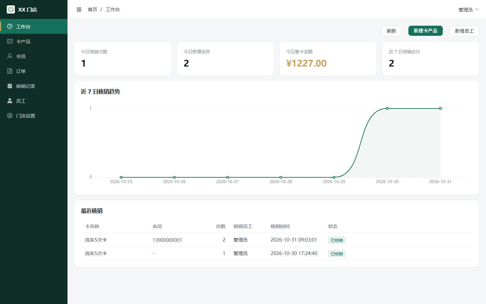
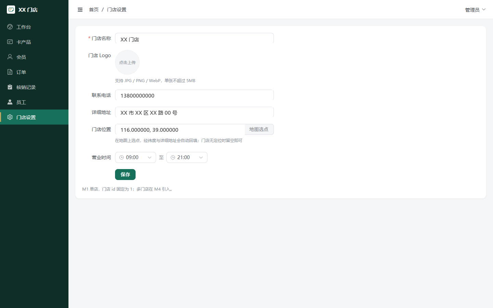
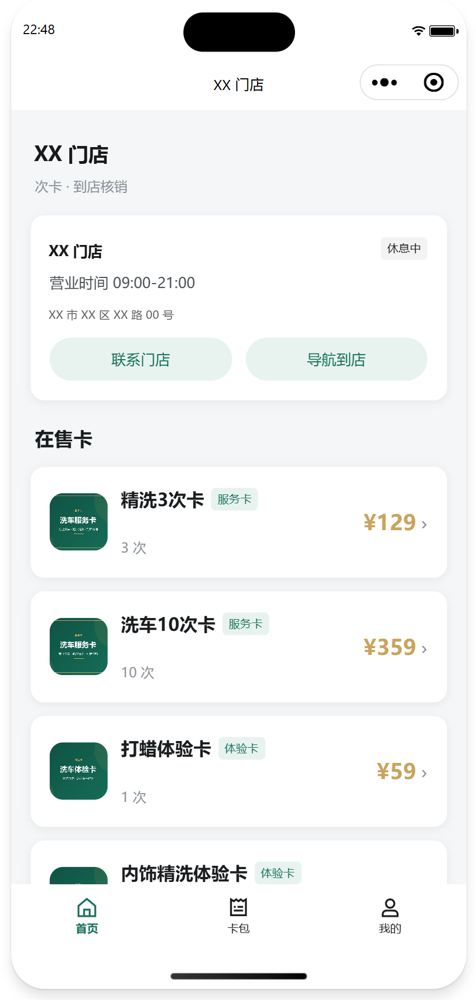
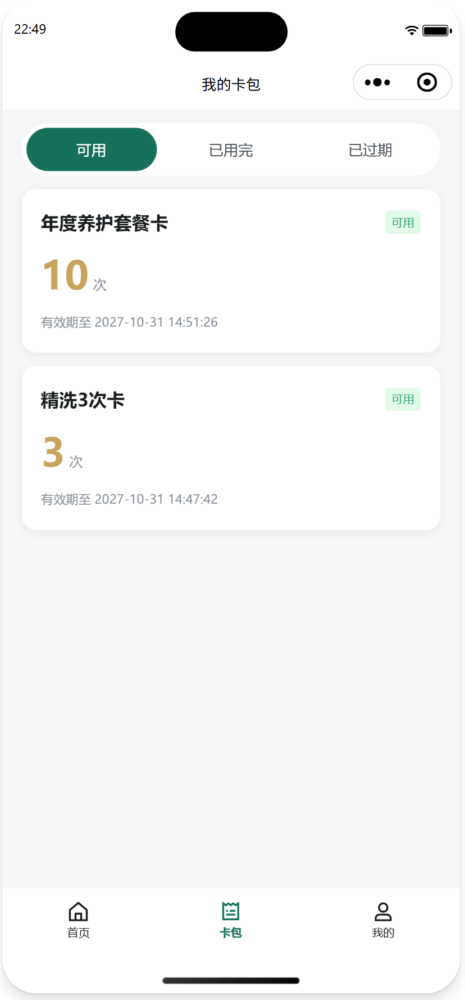
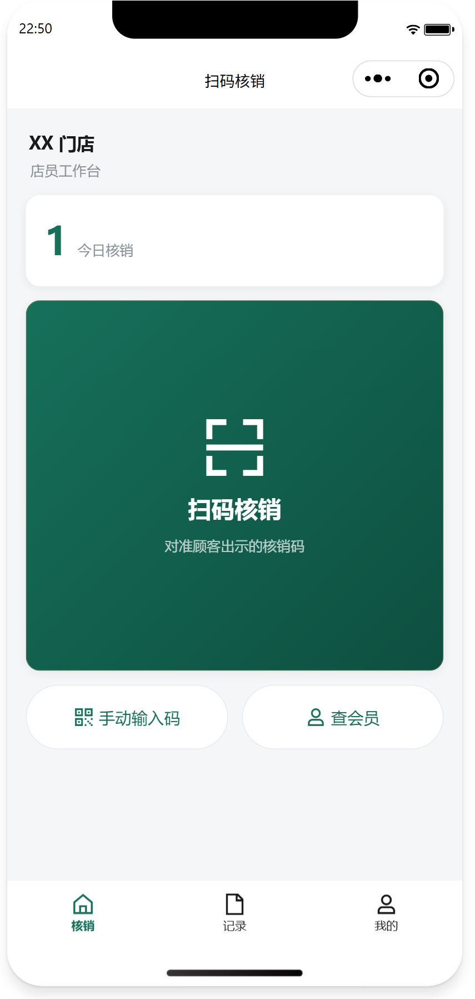
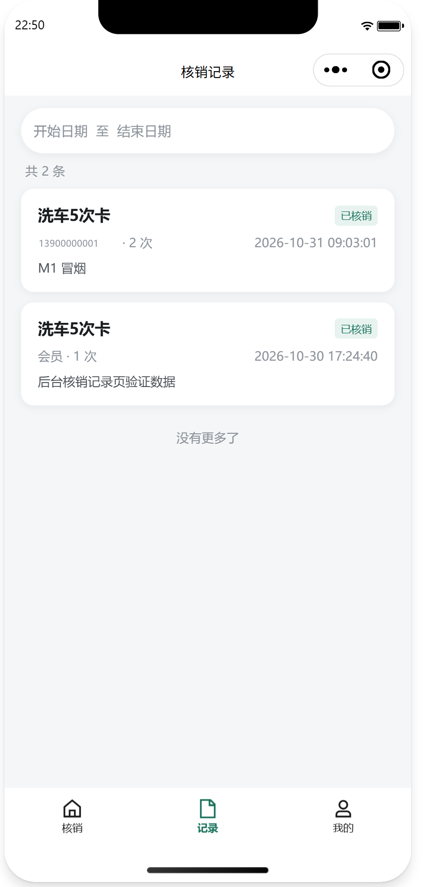

# 次卡商城

> 面向单店洗车/美容类商家的次卡系统：后台发卡，顾客在小程序买卡，到店出示核销码由店员扣次。

## 📋 目录

- [项目简介](#项目简介)
- [界面预览](#界面预览)
- [里程碑规划](#里程碑规划)
- [技术栈](#技术栈)
- [项目结构](#项目结构)
- [环境要求](#环境要求)
- [快速开始](#快速开始)
- [配置说明](#配置说明)
- [部署指南](#部署指南)
- [API 文档](#api-文档)
- [常见问题](#常见问题)

## 项目简介

商家用一张「次卡」把服务提前卖出去，顾客到店核销扣次。系统分三端：商家后台负责建卡、看数据、管员工与门店；客户小程序负责买卡、管卡包、出示核销码；店员小程序负责扫码核销、查会员、看核销记录。

### 核心功能

- [x] 商家后台：卡产品上架/下架、会员与持卡查询、订单与支付流水、核销记录、员工账号、门店设置（含地图选点与营业时间）
- [x] 客户小程序：门店展示与导航、卡详情、下单与 mock 支付、卡包（可用/已用完/已过期）、核销码（60 秒自动换码）、订单与使用记录、手机号授权门禁
- [x] 店员小程序：手机号密码登录、扫码或手输核销码、预览与确认扣次、核销记录、按手机号查会员
- [x] 后端：三端隔离的 JWT 双令牌（access 30 分钟 / refresh 12 小时）、核销码一次性校验、扣次 CAS + 幂等、图片上传（MinIO）
- [ ] 真实微信支付与退款（规划在 M2）
- [ ] 优惠券、储值、积分与会员等级（规划在 M3）
- [ ] 多门店与跨店结算（规划在 M4）

## 界面预览

商家后台：

| 工作台 | 门店设置 |
| --- | --- |
|  |  |

客户小程序：

| 首页 | 卡详情 |
| --- | --- |
|  |  |

店员小程序：

| 首页 | 核销记录 |
| --- | --- |
|  |  |

## 里程碑规划

| # | 里程碑 | 核心范围 | 出口标准 | 状态 |
| --- | --- | --- | --- | --- |
| M1 | 最小可用原型 | 发卡、买卡、核销三条链路；8 张表；mock 支付；单店单角色 | 真机跑通全链路；并发扣次不超扣；同 requestId 重放不重复扣；核销码 60 秒失效且只能用一次 | 已完成（支付为 mock） |
| M2 | 单店业务闭环 | 真实微信支付（JSAPI、回调、查单、退款）、员工角色权限、撤销核销、到期定时任务、订阅消息、操作日志 | 真实收款与退款各 1 笔、撤销 1 次核销后余次与流水账实相符；店员无退款与撤销权限 | 计划中（18–22 人日） |
| M3 | 商家运营能力 | 优惠券、储值、会员等级与积分、服务项目与技师、新人礼与分享、经营看板 | 券与次卡的叠加规则可配置且前后台结果一致；看板指标可与明细对账 | 计划中（25–30 人日） |
| M4 | 支持多门店 | 门店管理、跨店通用规则、门店维度权限与报表、跨店结算、员工调店 | 店长只看到本店数据；跨店核销按规则归属并可结算 | 计划中（20–25 人日） |
| M5（可选） | 增值迭代 | 预约与排班、卡转赠与礼品卡、评价晒单、到期与低余次提醒、员工提成 | 预约到店可一键核销并挂到预约单；转赠后原持卡人不可再用 | 按单项启动（5–10 人日/项） |

几点约束：

- M1 与 M2 的分界线是「钱能不能真收真退、账能不能对上」，支付渠道在 M1 已抽象成接口，M2 只加实现类与配置。
- M4 依赖 M1 表结构里预留的 `store_id`，数据不需要迁移。
- M5 不阻塞前四个里程碑，只在出现真实需求时启动单项。

## 技术栈

| 分类 | 技术 | 版本 |
| --- | --- | --- |
| 语言 | JDK | 8 |
| 后端框架 | Spring Boot | 2.7.18 |
| 安全 | Spring Security + JJWT | 5.7.x / 0.11.5 |
| ORM | MyBatis-Plus | 3.5.7 |
| 迁移 | Flyway | 8.5.x |
| 数据库 | MySQL | 8.0 |
| 缓存 | Redis | 6.2+ |
| 接口文档 | Knife4j（OpenAPI3） | 4.4.0 |
| 微信 | WxJava（miniapp） | 4.8.0 |
| 对象存储 | MinIO | 8.5.7 |
| 商家后台 | Vue 3 + TypeScript + Vite | 3.4.x / 5.4.x |
| 后台 UI | Element Plus + Pinia + ECharts | 2.8.x / 2.2.x / 5.5.x |
| 小程序 | 微信原生 + TDesign miniprogram | 基础库 2.32.3 / TDesign 1.17.0 |
| 地图 | 腾讯位置服务 JavaScript API GL | 1.exp |

## 项目结构

```text
card-mall/
├── server/                 # Spring Boot 单体后端，三端接口按 /api/app、/api/staff、/api/admin 划分
│   ├── src/main/java/       # 全局分层：controller / service / mapper / entity / dto / vo / security
│   └── src/main/resources/  # 配置、Flyway 迁移脚本、日志
├── admin-web/              # 商家后台（Vue3 + Element Plus），构建产物 dist 由 Nginx 托管
├── miniapp-customer/       # 客户小程序（微信原生 + TDesign），买卡、卡包、核销码
├── miniapp-staff/          # 店员小程序（微信原生 + TDesign），扫码核销、查会员
└── docs/                   # 设计文档、里程碑计划、验收清单
```

## 环境要求

- JDK 8（必须；项目编译级别为 1.8）
- Maven 3.8+
- Node.js 18+（商家后台，npm）
- MySQL 8.0、Redis 6.2+
- 微信开发者工具（小程序编译与真机调试，基础库 2.32.3+）
- MinIO（图片上传；不配置则上传接口不可用，其余功能不受影响）

## 快速开始

### 后端启动

先创建 `server/src/main/resources/application-local.yml`（该文件不入库，Flyway 会自动建库建表，无需手工导 SQL）：

```yaml
spring:
  datasource:
    username: root
    password: 你的数据库密码
  redis:
    password:
card-mall:
  jwt:
    secret: 至少 32 字节的随机字符串
  file:
    endpoint: http://127.0.0.1:9000
    access-key: minio账号
    secret-key: minio密码
    public-base: http://127.0.0.1:9000/card-mall
```

然后启动：

```bash
cd server
mvn spring-boot:run
```

Windows 下如果本机默认 JDK 高于 8，需要先在当前终端临时指定 JDK 8，`&&` 前后不能有空格，否则会污染 `JAVA_HOME`：

```cmd
set JAVA_HOME=C:\Java\jdk1.8.0_431&&set PATH=C:\Java\jdk1.8.0_431\bin;%PATH%&&cd server&&mvn spring-boot:run
```

首次启动会创建默认管理员 `13800000000 / 123456`，登录后应立即改密。

### 商家后台

```bash
cd admin-web
npm install
npm run dev
```

访问 http://localhost:5173 。开发期 `/api` 由 Vite 代理到 `http://localhost:8080`。

门店位置选点依赖腾讯地图 key，需在 `admin-web/.env.local` 中配置 `VITE_TMAP_KEY`（模板见 `.env.example`），改完重启 dev server 才生效。

### 客户小程序

1. 微信开发者工具「导入项目」，目录选 `miniapp-customer/`，AppID 填自己的（游客 AppID 下部分微信能力受限）
2. 工具栏「工具 → 构建 npm」，生成 `miniprogram_npm/`（TDesign 从这里加载，不构建会白屏）
3. 详情 → 本地设置 → 勾选「不校验合法域名、web-view、TLS 版本以及 HTTPS 证书」
4. 真机调试时把 `config/index.js` 的 `baseUrl` 从 `localhost` 改成本机局域网 IP（手机与电脑同一 WiFi）

### 店员小程序

步骤同上，目录选 `miniapp-staff/`。默认账号同样是 `13800000000 / 123456`，登录后进入首页扫码或手动输入核销码。

## 配置说明

| 配置项 | 位置 | 说明 | 默认值 |
| --- | --- | --- | --- |
| `spring.datasource.*` | `server/src/main/resources/application-local.yml` | 数据库连接，文件不入库 | - |
| `spring.redis.*` | 同上 | Redis 连接 | 127.0.0.1:6379 |
| `card-mall.jwt.secret` | 同上 | JWT 签名密钥，少于 32 字节启动失败 | - |
| `card-mall.jwt.access-expire-seconds` | `server/src/main/resources/application.yml` | access token 有效期（秒） | 1800 |
| `card-mall.jwt.refresh-expire-seconds` | 同上 | refresh token 有效期（秒），存 Redis 白名单 | 43200 |
| `card-mall.file.*` | `application-local.yml` | MinIO 地址、凭据与公开访问前缀 | - |
| `VITE_TMAP_KEY` | `admin-web/.env.local` | 腾讯位置服务 key（JavaScript API GL） | - |
| `ENV` / `baseUrl` | `miniapp-customer/config/index.js`、`miniapp-staff/config/index.js` | 接口地址；真机调试填电脑局域网 IP，换网络后同步修改 | 当前为 `http://localhost:8080/api` |

## 部署指南

后端打包与启动：

```bash
cd server
mvn clean package
java -jar target/card-mall-server-0.1.0-SNAPSHOT.jar
```

商家后台：

```bash
cd admin-web
npm run build
```

`dist/` 交给 Nginx 托管，`/api` 反向代理到后端 8080。生产环境应把 `application.yml` 中的 `knife4j.enable` 改为 `false`，避免接口文档暴露。

小程序：微信开发者工具「上传」生成体验版，联调通过后提交审核、发布。正式环境要求 HTTPS 域名，并在小程序后台配置为合法请求域名。

## API 文档

后端启动后访问 http://localhost:8080/doc.html （Knife4j），三端接口按 `/api/app`、`/api/staff`、`/api/admin` 前缀分区展示。

## 常见问题

**Q：`mvn` 编译报大量「找不到符号 getXxx()」？**
A：当前终端用的 JDK 不是 8，Lombok 注解处理没生效。按上文「后端启动」里的方式临时指定 JDK 8，不要改系统环境变量。

**Q：小程序真机上报「拒绝连接」？**
A：`config/index.js` 里的 `baseUrl` 还是 `localhost`，真机上 localhost 指向手机自己。改成本机 WLAN IPv4，并确认手机与电脑在同一 WiFi；可以先用手机浏览器访问 `http://<IP>:8080/api/admin/store` 验证通不通。

**Q：小程序打开白屏？**
A：没有在开发者工具里「构建 npm」，TDesign 组件加载不到。执行一次「工具 → 构建 npm」再编译。

**Q：后台门店选点提示「此key每日调用量已达到上限」？**
A：腾讯位置服务的搜索与逆地址解析按接口分别计配额。到控制台「配额管理」查看对应接口的已用量，调大额度或等次日重置。

**Q：支付是真的吗？**
A：M1 使用 mock 支付通道，下单后直接置为已支付并写流水。真实微信支付在 M2 接入，业务代码只依赖 `PayChannel` 接口，切换时不需要改下单与核销逻辑。
